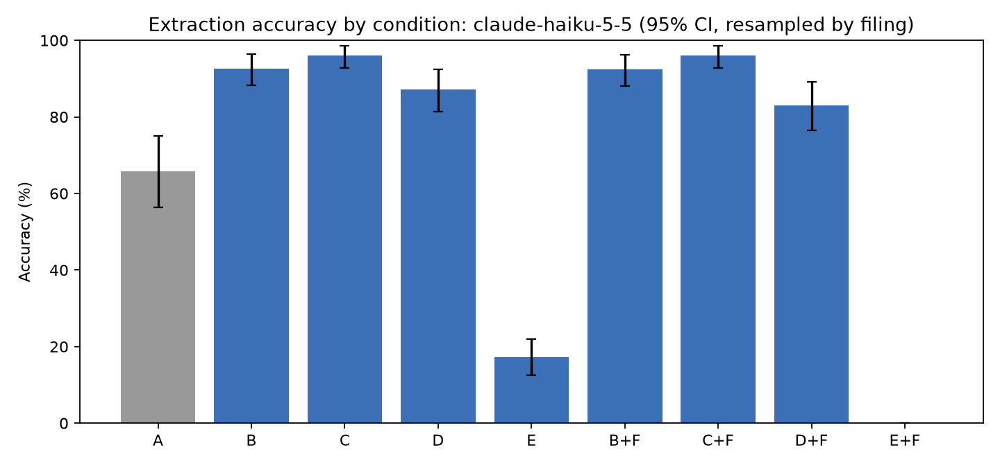
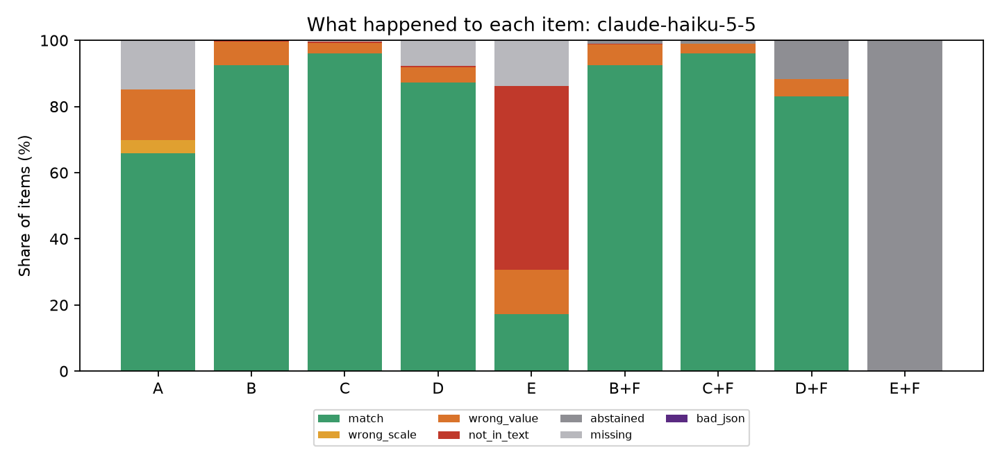

# 🧾 Measuring LLM Accuracy and Fabrication on SEC 10-K Extraction

**Measuring LLM Accuracy and Fabrication on SEC 10-K Extraction** is the **CMPT 218** final project at **Simon Fraser University** (Fall 2026). It measures how reliably a large language model pulls headline financial figures out of U.S. **SEC 10-K filings**, and what kind of mistake it makes when it gets one wrong.

**Goal:** Measure extraction accuracy and fabrication across prompting strategies, using the SEC's own XBRL data as an automatic answer key.

**Method:** Ask the model for four figures from 59 real 10-Ks under eight conditions, score every answer against XBRL, and classify each error.

The project ships with **FilingCheck**, a Streamlit app: type a company and watch the model read its latest 10-K and check every number against the SEC. A separate **Study** page presents the method and results.

📽 **[Presentation Slides](https://docs.google.com/presentation/d/1divSfITE-wAmH1aOVxVMiola7jt-2wkszGEeBeltQBM/edit?usp=sharing)** · 📄 **[Final Report](https://docs.google.com/document/d/1Mu42ck1ORVXcXztD8TKTjdiH-BiYJcWzOYDwvrkFJVw/edit?usp=sharing)**

---

# 🎯 Research Overview

LLMs are increasingly used to read long financial documents, but a 10-K is long, dense and full of near-identical numbers: several years side by side, segment and consolidated totals, figures in thousands or millions. A model can:

- Read the **wrong line, column or year**
- Get the **scale** wrong (thousands vs. millions)
- **Fabricate** a number that appears nowhere in the filing

This project asks three questions:

1. How does accuracy change across **prompting strategies** (zero-shot, few-shot, retrieval, closed-book) compared with a **rule-based baseline**?
2. When the model is wrong, **what kind of error** is it?
3. Does allowing the model to answer **"not found"** reduce fabrication?

Because the SEC publishes structured **XBRL** data for every filing, each answer can be scored automatically, with no hand labelling.

---

# 🖼 Pipeline Overview

```
Company ticker
        │
        ▼
Latest 10-K from SEC EDGAR
        │
        ├──────────────────────────────┐
        ▼                              ▼
Locate the financial statements     XBRL answer key (companyfacts API)
        │                              │
        ▼                              │
Extract under 8 conditions + regex    │
(JSON: value, unit, period, quote)    │
        │                              │
        ▼                              ▼
Score each answer against the key (within 1%)
        │
        ▼
Classify errors: wrong scale · wrong value · fabricated · abstained
        │
        ▼
Filing-level bootstrap confidence intervals
```

---

# 🔬 Method

1. **Sample** 60 large U.S. companies in 10 groups of 6, varied by sector and filing length; 59 filings downloaded and parsed. Banks are excluded (no standard revenue or operating income); JPMorgan is kept as a separate hard case.
2. **Build the answer key** from SEC XBRL, using only facts from that exact 10-K and fiscal period. Items whose alternative tags disagree by more than 0.1% are marked **ambiguous**; `check_keys.py` confirms each key is printed in the filing with the expected label.
3. **Extract** four fields (revenue, net income, operating income, total assets) under each condition, 3 repeats per item:

   | Condition | What the model sees |
   |---|---|
   | A | Rule/regex baseline, no model |
   | B | Zero-shot, financial statements only |
   | C | Few-shot: B plus 2 worked examples from held-out filings (KR, LOW, ITW, TGT) |
   | D | Retrieval: BM25 top passages (1,500-character chunks, top 3 per field) |
   | E | Closed-book: company and fiscal year only, no document |
   | +F | Abstention variant of B, C, D, E: the model may answer null |

4. **Require evidence:** every reply is JSON with the value, unit, period and a verbatim quote from the filing.
5. **Score and classify** every answer (see [Evaluation Metrics](#-evaluation-metrics)).
6. **Estimate uncertainty** with a filing-level bootstrap (2,000 resamples), since the four numbers from one filing are not independent.

---

# 📊 Results

Model: **Claude Haiku 5.5**. Accuracy is the share of items within 1% of the SEC value (95% CI in brackets). Fabrication is among answered items.

| Condition | Accuracy | Fabricated |
| --------- | -------- | ---------- |
| A · Regex baseline | 65.8% [56.4, 75.0] | 0.0% |
| B · Zero-shot | 92.6% [88.2, 96.4] | 0.5% |
| C · Few-shot | **96.0%** [92.8, 98.5] | 0.3% |
| D · Retrieval | 87.2% [81.4, 92.4] | 0.5% |
| E · Closed-book | 17.3% [12.5, 22.0] | **64.4%** |
| B+F · Zero-shot, may abstain | 92.4% | 0.2% |
| C+F · Few-shot, may abstain | 96.0% | 0.0% |
| D+F · Retrieval, may abstain | 83.0% | 0.0% |
| E+F · Closed-book, may abstain | 0.0% (abstains on every item) | — |

**Key findings** (paired differences on the same filings, 95% CI):

- **The model beats the regex baseline** by +26.7 points [17.5, 36.5].
- **Few-shot helps a little:** +3.5 points [0.5, 6.7] over zero-shot, but the gain disappears once ambiguous keys are removed.
- **Retrieval hurts:** −5.4 points [−10.4, −1.5]; it sometimes misses the statement the number is on.
- **Without the document, the model invents numbers:** closed-book is −75.4 points [−81.7, −69.2], and 64.4% of its answers appear nowhere in the filing.
- **Abstention removes the remaining fabrications** at little or no cost to accuracy.

With the 34 ambiguous answer keys excluded, zero-shot accuracy rises to **97.6%** and the regex baseline to **74.4%**.

<p align="center">
  
  
</p>

---

# 📈 Evaluation Metrics

Every answer receives exactly one label:

- **match:** within 1% of the SEC value
- **wrong_scale:** off by exactly 1,000× or 1,000,000×
- **wrong_value:** a number that appears in the filing but is not the SEC value (wrong line, period or column)
- **not_in_text (fabricated):** a number that appears nowhere in the filing
- **abstained:** answered null when allowed to
- **missing / bad_json:** no answer, or a reply that could not be parsed

Also reported: **answer rate**, **precision** (accuracy among answered items), **consistency** across the 3 repeats, and **quote-found rate** (whether the model's evidence quote really is in the filing).

---

# 🧱 Repository Structure

```
Measuring-LLM-Accuracy-and-Fabrication-on-SEC-10-K-Extraction/
│
├── README.md
├── app.py                  # FilingCheck app: home page (live check) and navigation
├── ui_pages.py             # Study page: method, results, findings, appendix
├── glass.py                # liquid-glass refraction effect for the UI
│
├── pipeline.py             # find the 10-K, build the XBRL key, extract and score
├── study.py                # experiment runner: prepare / estimate / run / status
├── analyze_study.py        # tables, confidence intervals, audit sample
├── check_keys.py           # automated check of the answer key against the filing text
├── companies.py            # 60-company sample, hard case, held-out few-shot filings
├── step2_xbrl.py           # early single-company (Apple) scripts the pipeline grew from
├── step3_filing.py
├── step4_extract.py
│
├── results/
│   └── study/              # summaries, prompts, raw model replies, figures
│
├── static/
│   └── bg.jpg              # site background
├── tools/
│   └── make_background.py  # regenerates the background (plus 1080p/4K slide versions)
│
└── .streamlit/
    └── config.toml         # theme and static file serving
```

Downloaded filings (`data/`) and API keys are not stored in this repository.

---

# 🚀 Running It

Requires Python 3.10+ and an Anthropic API key.

```bash
python -m venv venv
venv/bin/pip install streamlit anthropic requests beautifulsoup4 numpy pillow
export ANTHROPIC_API_KEY="..."
```

**The app**

```bash
venv/bin/python -m streamlit run app.py
```

Open http://localhost:8501. The study write-up is at http://localhost:8501/study.

**The study** (finished work is cached, so each step can be re-run safely)

```bash
venv/bin/python study.py prepare          # download filings, build answer keys, run the regex baseline (free)
venv/bin/python study.py estimate         # estimated API cost (free)
venv/bin/python study.py run --budget 5   # call the model; stops if the estimate passes the budget
venv/bin/python analyze_study.py          # tables and confidence intervals
venv/bin/python analyze_study.py --exclude-ambiguous
```

SEC EDGAR requires a descriptive `User-Agent` header with your name and email, and limits requests to about 10 per second.

---

# 🛠 Technologies

- Python
- Anthropic API (Claude Haiku 5.5)
- SEC EDGAR and XBRL `companyfacts` API
- BeautifulSoup (HTML parsing)
- BM25 retrieval
- Bootstrap confidence intervals
- Streamlit (FilingCheck app)

---

# 🚧 Limitations and Future Work

**Limitations**

- One model, four fields, large U.S. filers only
- XBRL answer keys can themselves be ambiguous (34 items)
- Banks and other filers without standard line items are excluded

**Future work**

- Compare more models, including open-source ones
- Extend to more fields, segment data and quarterly 10-Q filings
- Test neural (embedding) retrieval against BM25
- Hand-audit a larger sample of the answer key

---

# 📚 Related Research

Project documents:

- [Presentation Slides](https://docs.google.com/presentation/d/1divSfITE-wAmH1aOVxVMiola7jt-2wkszGEeBeltQBM/edit?usp=sharing)
- [Final Report](https://docs.google.com/document/d/1Mu42ck1ORVXcXztD8TKTjdiH-BiYJcWzOYDwvrkFJVw/edit?usp=sharing)

Selected references:

- Z. Chen et al., "FinQA: A Dataset of Numerical Reasoning over Financial Data," EMNLP, 2021.
- F. Zhu et al., "TAT-QA: A Question Answering Benchmark on a Hybrid of Tabular and Textual Content in Finance," ACL, 2021.
- P. Islam et al., "FinanceBench: A New Benchmark for Financial Question Answering," arXiv:2311.11944, 2023.
- U.S. Securities and Exchange Commission, EDGAR and XBRL financial data APIs (data.sec.gov).

The liquid-glass effect in `glass.py` is adapted from [liquid-glass-js](https://github.com/dashersw/liquid-glass-js) (MIT, © 2025 Armagan Amcalar).

---

# 👨‍💻 Authors

**William Huang** · **Vincent Zhao** · **James Park**

CMPT 218, Simon Fraser University

---

# 🙏 Acknowledgements

This project was completed as the final project for **CMPT 218** at **Simon Fraser University**, Fall 2026.

FilingCheck is a research project. Nothing here is financial advice.
